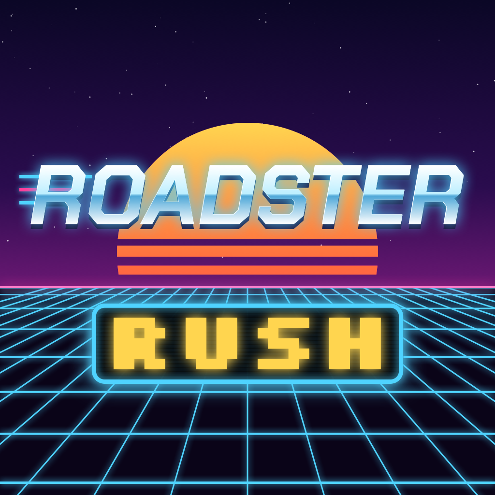

<p align="center">
  
</p>

<h1 align="center">Roadster Rush</h1>

<p align="center">
  A 3D arcade racer for iPhone. Fly the 2026 Roadster over piles of parked cars on an endless race track.<br>
  Built natively with Swift, SwiftUI and RealityKit.
</p>

---

## Screenshot


## About

Roadster Rush is a modern take on **F1 Race**, the classic game on old keypad phones where your car could jump over traffic. Here you drive a Roadster down a race circuit packed with grandstands, a cheering crowd and a city skyline, and use under-body jets to fly over stacks of parked cars.

## Features

- **Real 3D world**: RealityKit scene with a gradient sky, distance fog, real-time shadows and an endless race track
- **Flight physics**: gravity, jet thrust and a limited air tank; thrust follows the car's roll, so flying upside down pushes you down
- **Barrel rolls**: a flip modelled like a real reaction-control system (spin up, coast, brake), worth bonus points in the air
- **Landing ring**: shows where you'll land, green for track and red for cars
- **Live crowd**: grandstands full of spectators who cheer harder while you're airborne
- **Jet smoke and flames**, camera shake, haptics and sound effects
- **Retro UI**: LCD-style score, glass panels, pause and crash screens, best score saved on device

## How to play

| Action | Control |
| --- | --- |
| Fly up (uses air) | Hold **FLY**, or tap it for a short hop |
| Steer and aim your landing | **Joystick** |
| Barrel roll and side dash | **FLIP** |

- Touching a parked car ends the run.
- Air refills only while you drive on the track.
- A flip that finishes in the air is worth **+25**.
- Every 500 m the level goes up: the car gets faster and the stacks get taller and closer together.

## Requirements

- Xcode 27 or newer, with the Metal Toolchain component installed (Xcode → Settings → Components)
- iOS 18 or newer, iPhone, portrait

## Getting started

```bash
git clone https://github.com/AnishHazra/RoadsterRush.git
cd RoadsterRush
open RoadsterRush.xcodeproj
```

Select the **RoadsterRush** scheme and run it on an iPhone or simulator.

To watch the game play itself, enable the `-demo` launch argument in the scheme (Debug builds only).

## Project structure

```
RoadsterRush/
  App/              App entry and screen flow
  Core/
    Splash/         Asset loading and splash screen
    Title/          Title screen
    Game/
      Model/        Game state and physics
      Scene/        RealityKit world: track, crowd, car, jets, smoke, fog shader
      Views/        HUD, pause and crash screens
  Components/       Joystick, FLY / FLIP buttons, LCD digits, logo
  Services/         Sound (AVAudioEngine) and haptics
  Resources/        Colors, fonts, 3D models, sounds
tools/              Scripts for the car model conversion and the app icon
```

## Credits

- Based on the Flutter game [Roadster Hop](https://github.com/Munawer-Ali/Roadster_game) by Munawer Ali, which this project ports to native iOS. The Roadster mesh, parked-car meshes and sound effects come from that project.
- Fonts: [Chakra Petch](https://fonts.google.com/specimen/Chakra+Petch) and [Silkscreen](https://fonts.google.com/specimen/Silkscreen), both under the SIL Open Font License.
- Inspired by **F1 Race** on keypad phones.

## Disclaimer

This is a non-commercial fan project. It is not affiliated with or endorsed by Tesla, Inc. "Tesla", "Roadster" and "Cybertruck" are trademarks of their respective owners.
